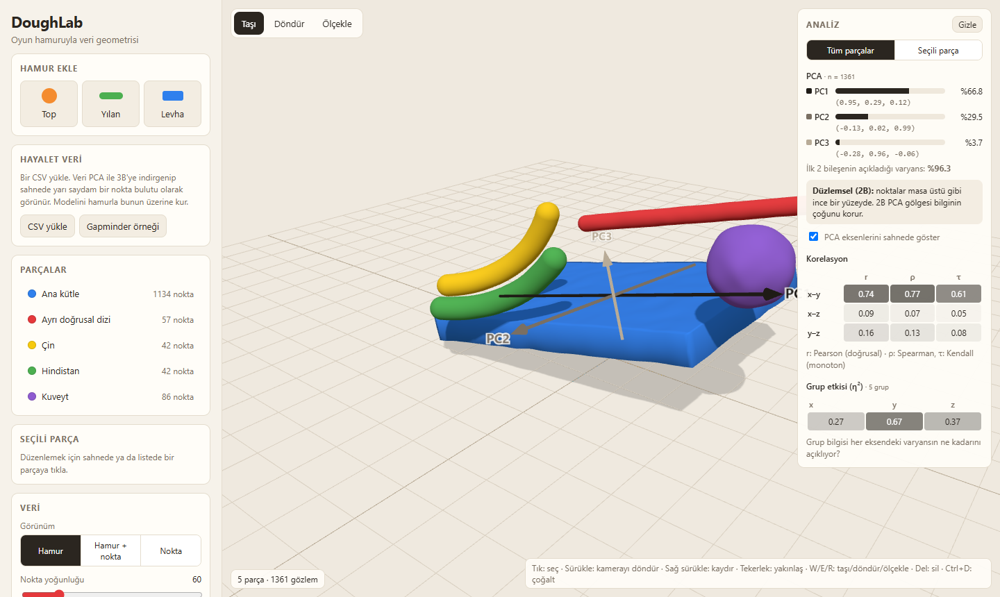
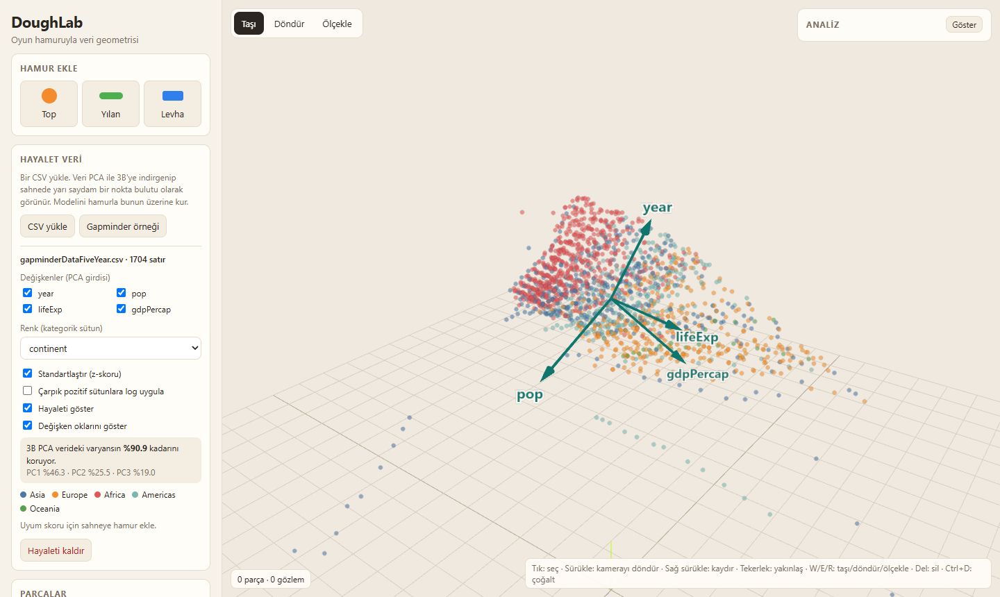

<div align="center">

# DoughLab

**Data geometry with play dough**

Sculpt 3D shapes from virtual dough in your browser and turn them into datasets, or reduce a real dataset to 3D and sculpt a model over it.

[](https://hbt00002.github.io/doughlab/)
[](LICENSE)


[Türkçe](README.md) · **English**

**[▶ Try it now: hbt00002.github.io/doughlab](https://hbt00002.github.io/doughlab/)**



</div>

> **Note:** The interface is available in English and Turkish. Switch with the **EN / TR** button in the top-left corner, or open the app with [`?lang=en`](https://hbt00002.github.io/doughlab/?lang=en).

## Contents

- [Why DoughLab?](#why-doughlab)
- [Features](#features)
- [Quick start](#quick-start)
- [Usage](#usage)
- [Dough-to-data mapping](#dough-to-data-mapping)
- [Using the data in Python / Colab](#using-the-data-in-python--colab)
- [How it works](#how-it-works)
- [Project structure](#project-structure)
- [Roadmap](#roadmap)
- [Contributing](#contributing)
- [License and acknowledgements](#license-and-acknowledgements)

## Why DoughLab?

One of the best ways to understand multidimensional data is to look at its **shape**. A flat surface suggests a linear model, a curved trail points to a nonlinear relationship, and a detached cluster hints at subgroups.

DoughLab grew out of a data science course assignment: model the 3D PCA plot of the Gapminder dataset with real play dough at home. The app makes that idea work in both directions:

- **From dough to data:** Sculpt a shape and DoughLab samples points from inside it, producing a real dataset. Bend it, add noise or add pieces, and watch PCA and correlations respond instantly.
- **From data to dough:** Load a CSV and DoughLab reduces it to 3D with PCA, placing it in the scene as a translucent "ghost". Sculpt your model over the ghost and track how well it fits.

## Features

### Modelling
- **Three piece types:** ball, snake and slab. Snakes and slabs can be bent.
- **Move, rotate and scale** gizmos; duplicate and delete.
- Per-piece **colour**, **dough type** (classic, glossy, glitter) and **texture**.
- **Save / load scenes as JSON** to share your models.

### Data generation
- Each piece produces points **in proportion to its volume**.
- **Texture** adds Gaussian noise to the points.
- Three views: **dough**, **dough + points** (translucent), **points only**.
- **Download the data as CSV** and analyse it in Colab.

### Live analysis
- **PCA:** explained variance, component loadings and a shape verdict (*linear*, *planar* or *volumetric*).
- **PCA axes** drawn as arrows in the scene.
- **Pearson, Spearman and Kendall** correlations for each axis pair, shown as a grayscale heatmap.
- **Group effect (η²):** how much of each axis's variance the group labels explain.
- Analyse **all pieces** or the **selected piece** only. Comparing the two is an easy way to see that a whole and its subgroup can show different patterns (Simpson's paradox).

### Regression
- Pick a **target axis** (e.g. `y`); it is regressed on the other two axes by least squares.
- The panel shows the model equation, **R²** and **RMSE**; the **regression plane** is drawn in the scene.
- A **residual plot** shows the errors in each piece's colour. When the residuals form a curve the app says so: bent dough is a nonlinear relationship that a flat plane cannot capture.

### Shadow mode
- Rotate the light with two sliders. The dough's **real shadow** and the **projection** of its points fall on a screen behind the data.
- The variance the shadow keeps is compared with the best possible shadow (**PC1 + PC2**).
- **Align with PCA** points the light along PC3, so the shadow on the screen becomes the 2D PCA plot itself. **Worst shadow** points it along PC1 and loses the most information.
- The shadow is also drawn as a 2D scatter plot in the panel.

### Ghost data mode



- Load your own CSV or fetch the **Gapminder** sample with one click.
- The chosen numeric columns are **reduced to 3D with PCA**; the retained variance is shown in the panel.
- Toggle **standardisation** and a **log transform** for skewed columns and see the effect immediately.
- Points are **coloured by a categorical column**, with a **loading arrow** (biplot) for every variable.
- **Hover** over a point to see its row.
- **Dough fit:** *coverage* and *spill* scores measure how well your dough model matches the data.

### Interface
- **English and Turkish** interface. Switch with the **EN / TR** button; the choice is remembered in the browser. You can also add `?lang=en` to the link.
- **Touch screen support:** tap to select, **Duplicate / Delete** buttons in the toolbar, bigger handles that are easy to grab with a finger, and tap a ghost point to see its row.

## Quick start

### Online

No installation needed: open **[hbt00002.github.io/doughlab](https://hbt00002.github.io/doughlab/)**. Any recent browser with WebGL 2 support will do.

### Locally

```bash
git clone https://github.com/hbt00002/doughlab.git
cd doughlab
python -m http.server 8000
```

Then open `http://localhost:8000`.

> The app uses ES modules, so serve it through a local server instead of opening `index.html` directly. Three.js is loaded from a CDN, so an internet connection is required.

## Usage

### Basic workflow

1. Pick a piece under **Add dough** and move, rotate or scale it in the scene.
2. Adjust size, bending, texture, colour and group name in **Selected piece**.
3. Watch PCA and correlations change in the **Analysis** panel.
4. Switch **View → Points** to see the generated data and export it with **Download CSV**.

### Sculpting over a ghost

1. Click **Ghost data → Gapminder sample**, or load your own CSV.
2. Choose the variables that go into PCA and the column used for colouring.
3. Place dough pieces over the ghost.
4. Push **Coverage** up and **Spill** down.

### Regression and shadow

1. Add some dough (or open the **Example scene**).
2. In **Analysis → Regression**, pick the target axis. Look at the plane, R² and the residual plot. Bend a snake and watch a curve appear in the residuals.
3. In **Analysis → Shadow**, rotate the light, then press **Align with PCA**. Watch how the shadow on the screen and the kept variance change.

### Mouse and keyboard

| Action | Control |
|---|---|
| Select a piece | Left click |
| Orbit the camera | Left drag |
| Pan the camera | Right drag |
| Zoom | Mouse wheel |
| Move / rotate / scale | `W` / `E` / `R` |
| Delete selected piece | `Delete` or `Backspace` |
| Duplicate selected piece | `Ctrl` + `D` |
| Clear selection | `Esc` |

### Touch screen

| Action | Control |
|---|---|
| Select a piece | Tap |
| Orbit the camera | One-finger drag |
| Zoom / pan | Two fingers |
| Move / rotate / scale | Toolbar at the top and the handles |
| Duplicate / delete | **Duplicate** / **Delete** in the toolbar |
| See a ghost row | Tap a ghost point |

## Dough-to-data mapping

| Dough | Data science concept |
|---|---|
| Colour / group name | Categorical variable (e.g. continent) |
| Size (volume) | Number of observations *n* |
| Texture | Noise: scatter of points around the surface |
| Bend | Nonlinear (curved) relationship |
| Separate pieces | Subgroups and clusters |
| Flat slab | Planar structure: the first two components explain most of the variance |
| Dough type | Appearance only, no effect on the data |

## Using the data in Python / Colab

The exported `doughlab-data.csv` has these columns:

| Column | Description |
|---|---|
| `x`, `y`, `z` | Scene coordinates of the point |
| `group` | Group name of the piece (categorical variable) |
| `piece` | Name of the piece |
| `shape` | `ball`, `snake` or `slab` |
| `dough` | `classic`, `glossy` or `glitter` |

```python
import pandas as pd
import seaborn as sns
from sklearn.decomposition import PCA

df = pd.read_csv("doughlab-data.csv")

pca = PCA(n_components=3).fit(df[["x", "y", "z"]])
print(pca.explained_variance_ratio_)

sns.pairplot(df, vars=["x", "y", "z"], hue="group")
```

## How it works

<details>
<summary><b>Point sampling</b></summary>

- Points are drawn uniformly inside the unbent piece by **rejection sampling**, then passed through the same bend transform as the mesh.
- Point count: `density × volume × |scale|`, capped at 5,000 points per piece.
- Texture adds Gaussian noise with `σ = 0.3 × texture` on every axis.
- Each piece has a fixed random seed, so its point cloud does not flicker as you adjust settings.

</details>

<details>
<summary><b>Live analysis</b></summary>

- **PCA** uses the covariance matrix of `x, y, z` (Jacobi eigenvalue method). All axes share the same unit, so no standardisation is applied.
- **Shape verdict:**
  - *linear* if PC1 ≥ 85%,
  - *planar* if PC1 + PC2 ≥ 90%,
  - *volumetric* otherwise.
- PCA axes in the scene span **±2 standard deviations** from the centroid.
- **Kendall's τ-b** is O(n²), so above 1,500 points it is computed on a fixed-seed subsample.
- **η²** = between-group sum of squares / total sum of squares.

</details>

<details>
<summary><b>Regression</b></summary>

- The target axis is regressed on the other two axes by **ordinary least squares** (centred normal equations).
- **R²** = 1 − SSE / SST, **RMSE** = √(SSE / n).
- The plane in the scene covers the data range of the two predictors, padded by 5%.
- **Curve detection:** the residuals are correlated with the square of the fitted value and of each predictor. If the strongest r² exceeds 0.1 the app warns and draws the residual plot against that axis. Predictors are checked too because a symmetric bend can leave the fitted value flat.

</details>

<details>
<summary><b>Shadow mode</b></summary>

- The light direction `d` (a unit vector) comes from the azimuth and elevation sliders. Every point is projected onto the plane perpendicular to `d`.
- **Kept variance** = 1 − (variance along `d` / total variance). The best value is PC1 + PC2, reached when `d` = PC3.
- The screen sits just behind the radius that holds 98% of the data. The scene's real light moves to the same direction, so the dough casts its shadow on the screen.

</details>

<details>
<summary><b>Ghost data</b></summary>

- **CSV parsing:** Comma, semicolon and tab delimiters are detected automatically. Decimal commas are supported in semicolon-delimited files. Up to 20,000 rows are used.
- **Missing values:** Rows with a missing value in any chosen column are dropped.
- **Log transform (optional):** `log10` is applied to columns whose values are all positive and whose skewness exceeds 1.
- **Scaling:** Columns are centred and, if standardisation is on, converted to z-scores before PCA.
- **Scene placement:** PC1 → x, PC2 → z (floor), PC3 → y (up). PC1 is scaled to span 10 scene units.
- **Fit score:** The radius is 5% of the ghost's width.
  - *Coverage:* share of ghost points with a dough point nearby.
  - *Spill:* share of dough points with no ghost point nearby.

**Validation:** On Gapminder (`year`, `pop`, `lifeExp`, `gdpPercap`, standardised), the first three components explain **46.3% + 25.5% + 19.0% = 90.9%** of the variance. With standardisation off, all variance collapses onto PC1 because `pop` dominates, which is a clear illustration of why standardisation matters.

</details>

## Project structure

There is no build step. Everything runs in the browser as plain ES modules.

```
index.html          UI skeleton
style.css           Styles
src/
  main.js           Scene, pieces, UI, analysis tabs, export
  i18n.js           English and Turkish interface strings
  geometry.js       Dough geometry, bending, surface texture
  sampling.js       Point sampling inside pieces
  analysis.js       PCA, Pearson, Spearman, Kendall, η², regression, projection
  ghost-data.js     CSV parsing, ghost PCA, fit score (no Three.js)
  ghost.js          Ghost point cloud and variable arrows
  arrows.js         Labelled 3D arrows
docs/               README images
```

## Roadmap

- [x] Live PCA, correlation and η² panel
- [x] Ghost point cloud from CSV with a dough fit score
- [x] **Shadow mode:** rotate a light and compare the 2D projection with the true PCA projection
- [x] Regression plane and residual plot
- [x] English interface
- [x] Touch screen improvements

## Contributing

Contributions are welcome.

- Open an [issue](https://github.com/hbt00002/doughlab/issues) to report a bug or suggest an idea.
- For code changes, fork the repository, work on a separate branch and open a pull request.
- Follow the existing code style. The project intentionally has no build step and no package manager.

## License and acknowledgements

Released under the [MIT](LICENSE) license.

- 3D rendering: [Three.js](https://threejs.org)
- The Gapminder sample is fetched at runtime from the [plotly/datasets](https://github.com/plotly/datasets) repository. Data originally from [Gapminder](https://www.gapminder.org).
