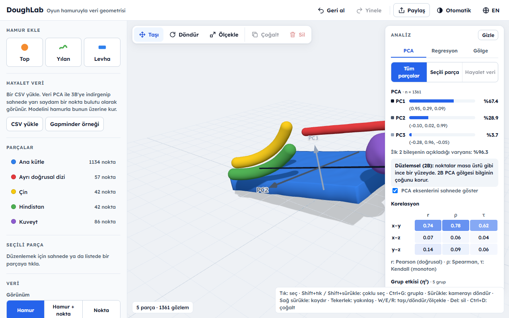
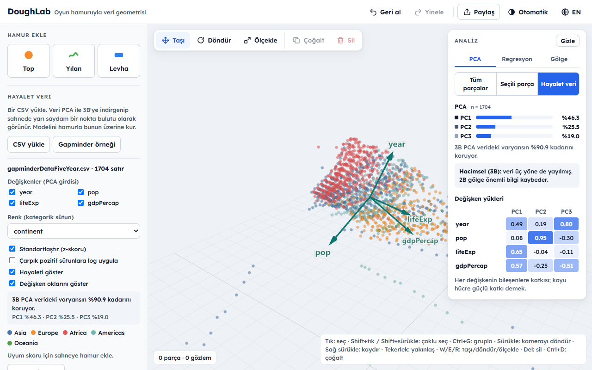

<div align="center">

# DoughLab

**Oyun hamuruyla veri geometrisi**

Tarayıcıda sanal hamurdan 3B şekiller yap, onları veri setine dönüştür ya da gerçek bir veri setini 3B'ye indirip üzerine hamurla model kur.

[](https://hbt00002.github.io/doughlab/)
[](LICENSE)


**Türkçe** · [English](README.en.md)

**[▶ Hemen dene: hbt00002.github.io/doughlab](https://hbt00002.github.io/doughlab/)**



</div>

## İçindekiler

- [Neden DoughLab?](#neden-doughlab)
- [Özellikler](#özellikler)
- [Hızlı başlangıç](#hızlı-başlangıç)
- [Kullanım](#kullanım)
- [Hamur ve veri karşılıkları](#hamur-ve-veri-karşılıkları)
- [Colab ile kullanım](#colab-ile-kullanım)
- [Nasıl çalışır?](#nasıl-çalışır)
- [Proje yapısı](#proje-yapısı)
- [Yol haritası](#yol-haritası)
- [Katkı](#katkı)
- [Lisans ve teşekkür](#lisans-ve-teşekkür)

## Neden DoughLab?

Çok boyutlu veriyi anlamanın en iyi yollarından biri, onun **şeklini** görmektir. Düz bir yüzey doğrusal bir modele, kıvrımlı bir iz doğrusal olmayan bir ilişkiye, ayrık bir küme ise alt gruplara işaret eder.

DoughLab, bir veri bilimi dersindeki ödevden doğdu: Gapminder verisinin 3B PCA grafiğini evde oyun hamuruyla modellemek. Uygulama bu fikri iki yönlü hale getirir:

- **Hamurdan veriye:** Bir şekil yap; DoughLab şeklin içinden noktalar örnekleyerek gerçek bir veri seti üretsin. Şekli büktükçe, gürültü ekledikçe ya da yeni parçalar koydukça PCA ve korelasyonların nasıl değiştiğini anında gör.
- **Veriden hamura:** Bir CSV yükle; DoughLab onu PCA ile 3B'ye indirip sahneye yarı saydam bir "hayalet" olarak koysun. Modelini hamurla bu hayaletin üzerine kur ve uyum skorunu takip et.

## Özellikler

### Modelleme
- **Üç parça türü:** top, yılan ve levha. Yılan ile levha bükülebilir.
- **Taşı, döndür ve ölçekle** araçları; çoğaltma ve silme.
- **Çoklu seçim:** `Shift` + tık ile parça ekle / çıkar ya da `Shift` + sürükle ile mavi seçim kutusu çiz. Seçili parçalar birlikte taşınır, döndürülür ve ölçeklenir.
- **Gruplama:** `Ctrl` + `G` seçili parçalara ilk seçilenin grup adını verir (verideki aynı kategori) ve onları birbirine bağlar; artık birlikte seçilip taşınırlar. `Ctrl` + `Shift` + `G` bağı çözer.
- Her parça için **renk**, **hamur türü** (klasik, parlak, simli) ve **doku** ayarı.
- Sahneyi **JSON olarak kaydet / aç**; modellerini başkalarıyla paylaş.

### Veri üretimi
- Her parçanın içinden **hacmiyle orantılı** sayıda nokta örneklenir.
- **Doku**, noktalara Gauss gürültüsü ekler.
- Üç görünüm: **hamur**, **hamur + nokta** (yarı saydam), **sadece nokta**.
- Veriyi **CSV olarak indir** ve Colab'da analiz et.

### Canlı analiz
- **PCA:** açıklanan varyans, bileşen yükleri ve şekil yorumu (*çizgisel*, *düzlemsel* veya *hacimsel*).
- **PCA eksenleri** sahnede ok olarak gösterilir.
- Eksen çiftleri için **Pearson, Spearman ve Kendall** korelasyonları, gri tonlu ısı haritası olarak.
- **Grup etkisi (η²):** grup etiketlerinin her eksendeki varyansın ne kadarını açıkladığı.
- Analiz **tüm parçalar** ya da yalnızca **seçili parça** için yapılabilir. Bütün ile alt grubun farklı örüntüler gösterebildiğini (Simpson paradoksu) görmenin kolay bir yolu.

### Regresyon
- Bir **hedef eksen** seç (ör. `y`); diğer iki eksen üzerinden en küçük kareler regresyonu kurulur.
- Model denklemi, **R²** ve **RMSE** panelde gösterilir; **regresyon düzlemi** sahnede yarı saydam olarak çizilir.
- **Residual grafiği**, hataları parçaların renkleriyle gösterir. Residual'larda eğri bir örüntü varsa uygulama bunu fark edip uyarır: bükülmüş bir hamur, düz bir düzlemle açıklanamayan doğrusal olmayan bir ilişkidir.

### Gölge modu
- Işığın yönünü ve yüksekliğini kaydırıcılarla değiştir. Hamurun **gerçek gölgesi** ve noktaların **projeksiyonu** verinin arkasındaki perdeye düşer.
- Gölgenin koruduğu varyans, mümkün olan en iyi gölgeyle (**PC1 + PC2**) karşılaştırılır.
- **PCA gölgesine hizala** ışığı PC3 yönüne çevirir: perdedeki gölge, 2B PCA grafiğinin ta kendisi olur. **En kötü gölge** ise ışığı PC1 yönüne çevirip en çok bilgiyi kaybettirir.
- Gölgenin 2B görünümü ayrıca panelde çizilir.

### Hayalet veri modu



- Kendi CSV'ni yükle ya da tek tıkla **Gapminder** örneğini getir.
- Seçilen sayısal sütunlar PCA ile **3B'ye indirgenir**. Korunan varyans oranı panelde gösterilir.
- **Standartlaştırma** ve çarpık sütunlara **log dönüşümü** açılıp kapatılabilir. Bu tercihlerin sonucu nasıl değiştirdiği anında görülür.
- Noktalar **kategorik bir sütuna göre** renklenir. Her değişken için bir **yük oku** (biplot) çizilir.
- Bir noktanın **üzerine gelince** o satırın değerleri görünür.
- **Hamur uyumu:** *kapsama* ve *taşma* skorları, hamur modelinin veriye ne kadar iyi oturduğunu ölçer.

### Çalışmanı koru ve paylaş
- **Geri al / yinele:** Son 100 adım. Bir kaydırıcıyı sürüklemek tek adım sayılır.
- **Otomatik kayıt:** Sahne ve Gapminder hayaleti tarayıcına kaydedilir; sayfayı yenileyince geri gelir.
- **Paylaş:** Sahne, kopyalanan bağlantının içine sıkıştırılarak gömülür. Bağlantıyı açan kişi aynı sahneyi (Gapminder hayaletiyle birlikte) görür.

### Arayüz
- **Türkçe ve İngilizce** arayüz. Sağ üstteki **EN / TR** düğmesiyle değiştir; seçim tarayıcıda hatırlanır. Bağlantıya `?lang=en` ekleyerek de açabilirsin.
- **Açık ve koyu tema:** Varsayılan olarak bilgisayarının ayarını izler; üst çubuktaki tema düğmesiyle değiştirilebilir.
- **Hayalet veri analizi:** Analiz panelinde **Hayalet veri** kapsamı seçilince PCA ve gölge doğrudan yüklenen veride çalışır; regresyon CSV'nin kendi sütunlarında kurulur (ör. lifeExp ← year, log(gdpPercap)).
- **Dokunmatik ekran:** Dokunarak seçme, **Çoklu seç** düğmesi, araç çubuğunda **Çoğalt / Sil**, büyük tutamaçlar ve hayalet noktasına dokununca satır bilgisi. Telefonda analiz paneli sahnenin altına yerleşir.
- **Erişilebilirlik:** Tüm arayüz klavyeyle kullanılabilir, ekran okuyucular düğmeleri ve analiz sonuçlarını okur, renk kontrastı WCAG 2.1 AA düzeyindedir. Seçili parçanın konumu, dönüşü ve ölçeği sayıyla da girilebilir.

## Hızlı başlangıç

### Çevrimiçi

Kurulum gerekmez: **[hbt00002.github.io/doughlab](https://hbt00002.github.io/doughlab/)** adresini aç. WebGL 2 destekleyen güncel bir tarayıcı yeterlidir.

### Yerelde

```bash
git clone https://github.com/hbt00002/doughlab.git
cd doughlab
python -m http.server 8000
```

Ardından tarayıcıda `http://localhost:8000` adresine git.

> Uygulama ES modülleri kullandığı için `index.html` dosyasını doğrudan açmak yerine bir yerel sunucu gerekir. Three.js CDN üzerinden yüklendiği için internet bağlantısı da gerekir.

## Kullanım

### Temel iş akışı

1. **Hamur ekle** bölümünden bir parça seç ve sahnede taşı, döndür, ölçekle.
2. **Seçili parça** panelinde boyutları, bükülmeyi, dokuyu, rengi ve grup adını ayarla.
3. **Analiz** panelinde PCA ve korelasyonların değişimini izle.
4. **Görünüm → Nokta** ile hamurun ürettiği veriyi gör, **CSV indir** ile dışa aktar.

### Hayalet ile modelleme

1. **Hayalet veri → Gapminder örneği** butonuna bas ya da kendi CSV'ni yükle.
2. PCA'ya girecek değişkenleri ve renklendirme sütununu seç.
3. Hamur parçalarını hayaletin üzerine yerleştir.
4. **Kapsama** skorunu yükseltip **taşma** skorunu düşürmeye çalış.

### Regresyon ve gölge

1. Sahneye hamur ekle (ya da **Örnek sahne**'yi aç).
2. **Analiz → Regresyon** sekmesinde hedef ekseni seç. Düzlemi, R²'yi ve residual grafiğini incele. Bir yılanı bükerek residual'larda eğrinin belirdiğini gör.
3. **Analiz → Gölge** sekmesinde ışığı döndür, sonra **PCA gölgesine hizala**'ya bas. Perdedeki gölgenin ve korunan varyansın nasıl değiştiğini izle.

### Fare ve klavye

| Eylem | Kontrol |
|---|---|
| Parça seç | Sol tık |
| Seçime ekle / çıkar | `Shift` + tık |
| Kutu ile çoklu seç | `Shift` + sürükle |
| Tümünü seç | `Ctrl` + `A` |
| Gruplandır / grubu çöz | `Ctrl` + `G` / `Ctrl` + `Shift` + `G` |
| Kamerayı döndür | Sol tuşla sürükle |
| Kamerayı kaydır | Sağ tuşla sürükle |
| Yakınlaş / uzaklaş | Fare tekerleği |
| Taşı / döndür / ölçekle | `W` / `E` / `R` |
| Seçili parçaları sil | `Delete` veya `Backspace` |
| Seçili parçaları çoğalt | `Ctrl` + `D` |
| Seçimi kaldır | `Esc` |
| Geri al | `Ctrl` + `Z` |
| Yinele | `Ctrl` + `Shift` + `Z` veya `Ctrl` + `Y` |
| Seçiliyi kaydır (sahne odaktayken) | Ok tuşları (`Shift` ile 10 kat) |
| Seçiliyi yukarı / aşağı taşı | `Page Up` / `Page Down` |
| Analiz sekmeleri arasında geç | Sekme odaktayken ← / → |

### Dokunmatik ekran

| Eylem | Kontrol |
|---|---|
| Parça seç | Dokun |
| Kamerayı döndür | Tek parmakla sürükle |
| Yakınlaş / kaydır | İki parmak |
| Taşı / döndür / ölçekle | Üstteki araç çubuğu ve tutamaçlar |
| Çoğalt / sil | Araç çubuğundaki **Çoğalt** / **Sil** |
| Birden fazla parça seç | **Çoklu seç** düğmesini aç, sonra parçalara dokun |
| Hayalet satırını gör | Hayalet noktasına dokun |

### Gizlilik

- Otomatik kayıt yalnızca senin tarayıcında durur; hiçbir sunucuya gönderilmez.
- Paylaşım bağlantısı sahneyi adresin `#` işaretinden sonraki kısmında taşır. Bu kısım tarayıcıdan sunucuya hiç gönderilmez.
- Kendi yüklediğin CSV dosyası ne kaydedilir ne de bağlantıya eklenir.

## Hamur ve veri karşılıkları

| Hamur | Veri bilimi kavramı |
|---|---|
| Renk / grup adı | Kategorik değişken (ör. kıta) |
| Büyüklük (hacim) | Gözlem sayısı *n* |
| Doku | Gürültü: noktaların yüzeyden saçılması |
| Bükülme | Doğrusal olmayan (eğrisel) ilişki |
| Ayrı parçalar | Alt gruplar ve kümeler |
| Düz levha | Düzlemsel yapı: ilk iki bileşen varyansın çoğunu açıklar |
| Hamur türü | Yalnızca görünüm, veriyi etkilemez |

## Colab ile kullanım

İndirilen `doughlab-data.csv` dosyası şu sütunları içerir:

| Sütun | Açıklama |
|---|---|
| `x`, `y`, `z` | Noktanın sahnedeki koordinatları |
| `group` | Parçaya verilen grup adı (kategorik değişken) |
| `piece` | Parçanın adı |
| `shape` | `ball`, `snake` veya `slab` |
| `dough` | `classic`, `glossy` veya `glitter` |

```python
import pandas as pd
import seaborn as sns
from sklearn.decomposition import PCA

df = pd.read_csv("doughlab-data.csv")

pca = PCA(n_components=3).fit(df[["x", "y", "z"]])
print(pca.explained_variance_ratio_)

sns.pairplot(df, vars=["x", "y", "z"], hue="group")
```

## Nasıl çalışır?

<details>
<summary><b>Nokta örnekleme</b></summary>

- Noktalar, parçanın bükülmemiş hali içinde **reddetme örneklemesiyle** (rejection sampling) düzgün dağılımlı olarak üretilir. Ardından aynı bükme dönüşümü uygulanır.
- Nokta sayısı: `yoğunluk × hacim × |ölçek|`. Parça başına en fazla 5.000 nokta.
- Doku, her eksene `σ = 0.3 × doku` standart sapmalı Gauss gürültüsü ekler.
- Her parçanın sabit bir rastgele tohumu (seed) vardır. Böylece ayarlar değiştikçe nokta bulutu titremez.

</details>

<details>
<summary><b>Canlı analiz</b></summary>

- **PCA**, `x, y, z` koordinatlarının kovaryans matrisi üzerinden hesaplanır (Jacobi özdeğer yöntemi). Tüm eksenler aynı birimde olduğu için standartlaştırma yapılmaz.
- **Şekil yorumu:**
  - PC1 ≥ %85 ise *çizgisel*,
  - PC1 + PC2 ≥ %90 ise *düzlemsel*,
  - aksi halde *hacimsel*.
- Sahnedeki PCA eksenleri ağırlık merkezinden **±2 standart sapma** uzunluğundadır.
- **Kendall τ-b** O(n²) karmaşıklıktadır. Bu yüzden 1.500 noktadan fazlası olduğunda sabit tohumlu bir alt örnekle hesaplanır.
- **η²** = gruplar arası kareler toplamı / toplam kareler toplamı.

</details>

<details>
<summary><b>Regresyon</b></summary>

- Hedef eksen, diğer iki eksen üzerine **en küçük kareler** yöntemiyle regrese edilir (merkezlenmiş normal denklemler).
- **R²** = 1 − SSE / SST, **RMSE** = √(SSE / n).
- Sahnedeki düzlem, iki açıklayıcı eksenin veri aralığını (%5 payla) kaplar.
- **Eğri tespiti:** Residual'ların, tahmin değerinin ve her açıklayıcı eksenin karesiyle korelasyonuna bakılır. En güçlü r² 0,1'i geçerse uyarı verilir ve residual grafiği o eksene göre çizilir. Simetrik bir bükülmede tahmin değeri düz kalabildiği için açıklayıcı eksenlere de bakılır.

</details>

<details>
<summary><b>Gölge modu</b></summary>

- Işık yönü `d` (birim vektör), yatay açı ve yükseklikten hesaplanır. Her nokta, `d`'ye dik düzleme izdüşürülür.
- **Korunan varyans** = 1 − (`d` yönündeki varyans / toplam varyans). En iyi değer PC1 + PC2'dir ve `d` = PC3 iken elde edilir.
- Perde, verinin %98'ini içeren yarıçapın biraz arkasına konur. Sahnedeki gerçek ışık da aynı yöne taşınır; böylece hamurun gölgesi perdeye düşer.

</details>

<details>
<summary><b>Hayalet veri</b></summary>

- **CSV okuma:** Virgül, noktalı virgül ve sekme ayraçları otomatik algılanır. Noktalı virgüllü dosyalarda ondalık virgül desteklenir. En fazla 20.000 satır kullanılır.
- **Eksik değerler:** Seçilen sütunlardan birinde değer eksik olan satırlar çıkarılır.
- **Log dönüşümü (isteğe bağlı):** Tüm değerleri pozitif ve çarpıklığı 1'den büyük olan sütunlara `log10` uygulanır.
- **Ölçekleme:** Sütunlar merkezlenir; standartlaştırma açıksa z-skoruna çevrilir. Ardından PCA uygulanır.
- **Sahneye yerleştirme:** PC1 → x, PC2 → z (zemin), PC3 → y (yukarı). PC1 sahnede 10 birim genişliğe ölçeklenir.
- **Uyum skoru:** Hayaletin genişliğinin %5'i yarıçap olarak kullanılır.
  - *Kapsama:* Yakınında hamur noktası bulunan hayalet noktalarının oranı.
  - *Taşma:* Yakınında hiç hayalet noktası olmayan hamur noktalarının oranı.

**Doğrulama:** Gapminder verisinde (`year`, `pop`, `lifeExp`, `gdpPercap`, standartlaştırılmış) ilk üç bileşen varyansın **%46.3 + %25.5 + %19.0 = %90.9**'unu açıklar. Standartlaştırma kapatıldığında varyansın tamamı PC1'de toplanır, çünkü `pop` diğer değişkenleri bastırır. Bu, standartlaştırmanın önemini gösteren güzel bir örnektir.

</details>

## Proje yapısı

Derleme adımı yoktur. Tüm kod tarayıcıda doğrudan çalışan ES modüllerinden oluşur.

```
index.html          Arayüz iskeleti (import map'teki sürüm damgalarıyla)
style.css           Tasarım değişkenleri, açık ve koyu tema
fonts/              Lexend (OFL lisanslı)
src/
  main.js           Başlangıç ve düğme bağlantıları
  state.js          Paylaşılan durum
  scene.js          Three.js sahnesi, kamera, ışıklar, tema renkleri
  pieces.js         Parçalar, sahne dosyası, CSV dışa aktarma
  selection.js      Seçim, kutu seçimi, gruplama, gizmo, klavye
  panels.js         Parça listesi, seçili parça paneli, başlangıç kartı
  analysis-ui.js    Analiz paneli: PCA, regresyon ve gölge sekmeleri
  ghost-ui.js       Hayalet veri paneli, uyum skoru, satır bilgisi
  history.js        Geri al / yinele geçmişi (DOM'suz)
  history-ui.js     Geçmişin sahneye bağlanması
  storage.js        Tarayıcı kaydı ve paylaşım bağlantısı kodlaması (DOM'suz)
  autosave.js       Otomatik kayıt
  share.js          Paylaş düğmesi ve bağlantıyla açılış
  theme.js          Açık / koyu tema
  icons.js          SVG ikonlar
  ui.js             DOM yardımcıları, bildirimler, ekran okuyucu duyuruları
  i18n.js           Türkçe ve İngilizce arayüz metinleri
  analysis.js       PCA, korelasyonlar, η², regresyon, projeksiyon (DOM'suz)
  ghost-data.js     CSV okuma, hayalet PCA'sı, uyum skoru (DOM'suz)
  ghost.js          Hayalet nokta bulutu ve değişken okları
  geometry.js       Hamur geometrileri, bükme, yüzey dokusu
  sampling.js       Parça içinden nokta örnekleme
  arrows.js         Etiketli 3B oklar
tests/              node:test testleri
tools/              stamp-version.mjs (sürüm damgası)
docs/               README görselleri, tasarım ve plan belgeleri
```

## Yol haritası

- [x] Canlı PCA, korelasyon ve η² paneli
- [x] CSV'den hayalet nokta bulutu ve hamur uyum skoru
- [x] **Gölge modu:** ışığı döndürüp 2B projeksiyonu gerçek PCA projeksiyonuyla karşılaştırma
- [x] Regresyon düzlemi ve residual grafiği
- [x] İngilizce arayüz seçeneği
- [x] Dokunmatik ekran iyileştirmeleri
- [x] Geri al / yinele, otomatik kayıt ve paylaşım bağlantısı
- [x] Koyu tema ve erişilebilirlik (WCAG 2.1 AA)
- [ ] Dokunmatik ekranda kutu ile seçim
- [ ] Geri al geçmişinin sayfa yenilense de korunması

## Katkı

Katkılar memnuniyetle karşılanır.

- Hata bildirmek ya da öneride bulunmak için bir [issue](https://github.com/hbt00002/doughlab/issues) aç.
- Kod değişikliği için depoyu *fork*'la, ayrı bir dalda çalış ve bir *pull request* gönder.
- Mevcut kod stiline uy. Proje bilinçli olarak derleme adımı ve bağımlılık yöneticisi olmadan tutuluyor.

### Sürüm yayınlama

1. Testleri çalıştır: `node --test "tests/**/*.test.mjs"`
2. Sürüm damgasını güncelle: `node tools/stamp-version.mjs`. Bu komut `index.html`'deki tüm modül ve stil adreslerine yeni bir `?v=` damgası yazar; böylece tarayıcılar eski ve yeni dosyaları karıştırmaz. Damga unutulursa testlerden biri hata verir.
3. Commit et ve push'la. GitHub Actions testleri her push'ta yeniden çalıştırır.

## Lisans ve teşekkür

[MIT](LICENSE) lisansı ile yayınlanmıştır.

- 3B görselleştirme: [Three.js](https://threejs.org)
- Gapminder örnek verisi çalışma anında [plotly/datasets](https://github.com/plotly/datasets) deposundan indirilir. Veri [Gapminder](https://www.gapminder.org) kaynaklıdır.
